# Inventario por script — bidset_SIN_MARKUPS.pdf

md5 `09864273b408ee59625cc837ebf118ae` · 69 páginas · coordenadas en pt de la página ROTADA (como el PNG) · generado por inventario_tags.py (sin lectura a ojo)

## Partition types (del schedule / leyenda del PDF)

- **1A** — 1A/A-410 (detalle del type; schedule raster, leído con imagen)
- **1** — 1/A-410 (detalle del type; schedule raster, leído con imagen)
- **1B** — 1B/A-410 (detalle del type; schedule raster, leído con imagen)
- **1C** — 1C/A-410 (detalle del type; schedule raster, leído con imagen)
- **2** — 2/A-410 (detalle del type; schedule raster, leído con imagen)
- **5** — 5/A-410 (detalle del type; schedule raster, leído con imagen)
- **3** — 3/A-410 (detalle del type; schedule raster, leído con imagen)
- **4** — 4/A-410 (detalle del type; schedule raster, leído con imagen)
- **H1** — G/A-221 (detalle del type; schedule raster, leído con imagen)
- **H2a** — G/A-221 (detalle del type; schedule raster, leído con imagen)
- **H2b** — G/A-221 (detalle del type; schedule raster, leído con imagen)
- **H3a** — H/A-221 (detalle del type; schedule raster, leído con imagen)
- **H3b** — H/A-221 (detalle del type; schedule raster, leído con imagen)
- **E2** — E/A-221 (detalle del type; schedule raster, leído con imagen)
- **E1** — E/A-221 (detalle del type; schedule raster, leído con imagen)
- **F** — F/A-221 (detalle del type; schedule raster, leído con imagen)
- **I** — I/A-221 (detalle del type; schedule raster, leído con imagen)
- **A** — A/A-221 (detalle del type; schedule raster, leído con imagen)
- **B** — B/A-221 (detalle del type; schedule raster, leído con imagen)
- **D** — D/A-221 (detalle del type; schedule raster, leído con imagen)
- **C** — C/A-221 (detalle del type; schedule raster, leído con imagen)

## Ocurrencias por type y hoja (solo tags en símbolo, en hojas de planta)

| Type | A-101 p.6 | A-221 p.15 | TOTAL | ambiguos (exigen disposición) |
|---|---|---|---|---|
| 1A | 3 | 0 | **3** | 0 |
| 1 | 4 | 0 | **4** | 0 |
| 1B | 9 | 0 | **9** | 0 |
| 1C | 4 | 0 | **4** | 0 |
| 2 | 11 | 0 | **11** | 0 |
| 5 | 1 | 0 | **1** | 0 |
| 3 | 4 | 0 | **4** | 0 |
| 4 | 1 | 0 | **1** | 0 |
| H1 | 0 | 2 | **2** | 0 |
| H2a | 0 | 1 | **1** | 0 |
| H2b | 0 | 1 | **1** | 0 |
| H3a | 0 | 1 | **1** | 0 |
| H3b | 0 | 1 | **1** | 0 |
| E2 | 0 | 1 | **1** | 0 |
| E1 | 0 | 2 | **2** | 0 |
| F | 0 | 1 | **1** | 0 |
| I | 0 | 4 | **4** | 0 |
| A | 0 | 3 | **3** | 0 |
| B | 0 | 1 | **1** | 0 |
| D | 0 | 1 | **1** | 0 |
| C | 0 | 1 | **1** | 0 |

## Ocurrencias contadas (lista numerada, una imagen por ocurrencia)

Vista de hoja A-101 p.6 con cada tag circulado y numerado: 
Vista de hoja A-221 p.15 con cada tag circulado y numerado: 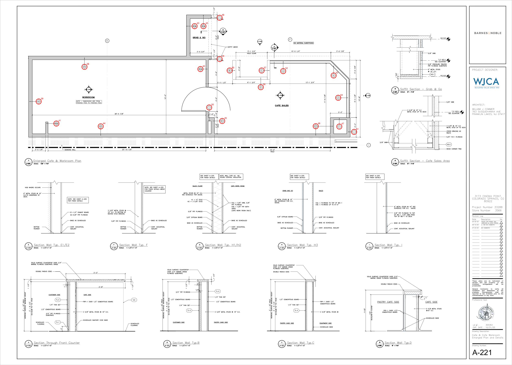

1. `PT0001` **1A** — A-101 p.6 @ (395, 504) pt · símbolo rombo · 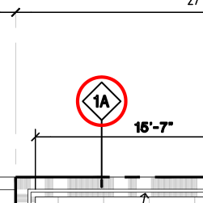 ✔
2. `PT0002` **1A** — A-101 p.6 @ (315, 767) pt · símbolo rombo · 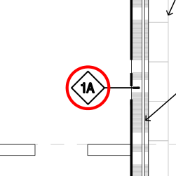 ✔
3. `PT0003` **1A** — A-101 p.6 @ (315, 966) pt · símbolo rombo · 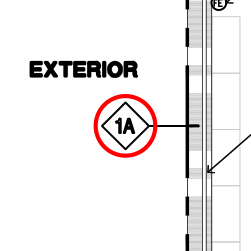 ✔
4. `PT0004` **1** — A-101 p.6 @ (945, 504) pt · símbolo rombo · 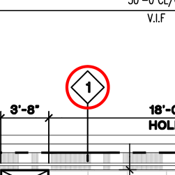 ✔
5. `PT0005` **1** — A-101 p.6 @ (1648, 504) pt · símbolo rombo · 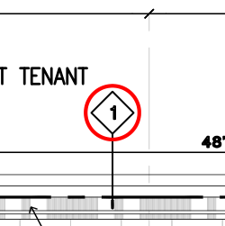 ✔
6. `PT0006` **1** — A-101 p.6 @ (802, 1460) pt · símbolo rombo · 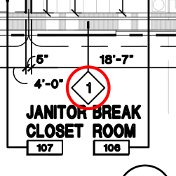 ✔
7. `PT0007` **1** — A-101 p.6 @ (1200, 1460) pt · símbolo rombo · 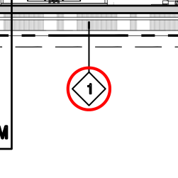 ✔
8. `PT0008` **1B** — A-101 p.6 @ (1981, 580) pt · símbolo rombo · 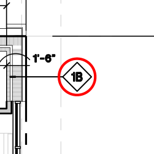 ✔
9. `PT0009` **1B** — A-101 p.6 @ (1908, 768) pt · símbolo rombo · 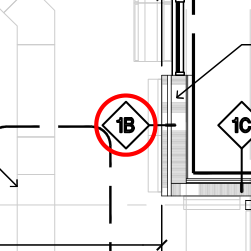 ✔
10. `PT0010` **1B** — A-101 p.6 @ (209, 1191) pt · símbolo rombo · 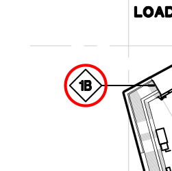 ✔
11. `PT0011` **1B** — A-101 p.6 @ (1984, 1210) pt · símbolo rombo · 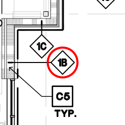 ✔
12. `PT0012` **1B** — A-101 p.6 @ (253, 1348) pt · símbolo rombo · 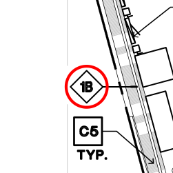 ✔
13. `PT0013` **1B** — A-101 p.6 @ (1984, 1392) pt · símbolo rombo · 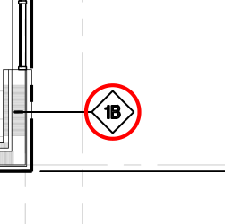 ✔
14. `PT0014` **1B** — A-101 p.6 @ (1650, 1447) pt · símbolo rombo · 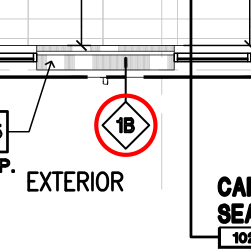 ✔
15. `PT0015` **1B** — A-101 p.6 @ (1868, 1447) pt · símbolo rombo · 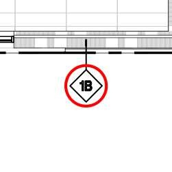 ✔
16. `PT0016` **1B** — A-101 p.6 @ (456, 1460) pt · símbolo rombo · 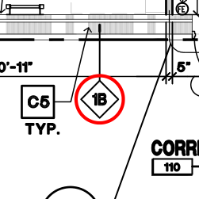 ✔
17. `PT0017` **1C** — A-101 p.6 @ (1964, 768) pt · símbolo rombo · 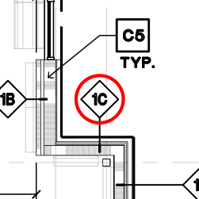 ✔
18. `PT0018` **1C** — A-101 p.6 @ (2026, 819) pt · símbolo rombo · 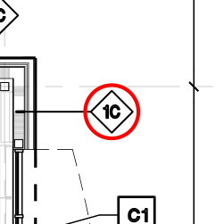 ✔
19. `PT0019` **1C** — A-101 p.6 @ (2026, 1147) pt · símbolo rombo · 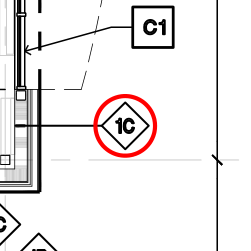 ✔
20. `PT0020` **1C** — A-101 p.6 @ (1964, 1194) pt · símbolo rombo · 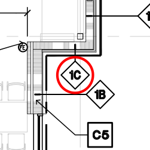 ✔
21. `PT0021` **2** — A-101 p.6 @ (1522, 583) pt · símbolo rombo · 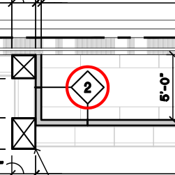 ✔
22. `PT0022` **2** — A-101 p.6 @ (453, 892) pt · símbolo rombo · 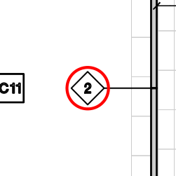 ✔
23. `PT0023` **2** — A-101 p.6 @ (453, 1266) pt · símbolo rombo · 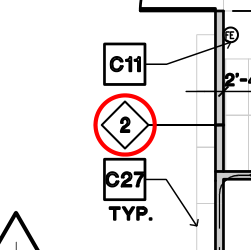 ✔
24. `PT0024` **2** — A-101 p.6 @ (722, 1266) pt · símbolo rombo · 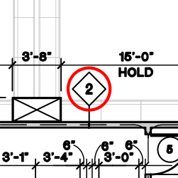 ✔
25. `PT0025` **2** — A-101 p.6 @ (892, 1266) pt · símbolo rombo · 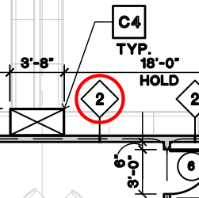 ✔
26. `PT0026` **2** — A-101 p.6 @ (950, 1266) pt · símbolo rombo · 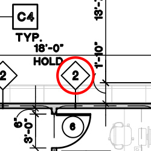 ✔
27. `PT0027` **2** — A-101 p.6 @ (916, 1348) pt · símbolo rombo · 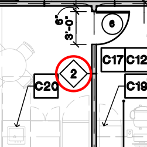 ✔
28. `PT0028` **2** — A-101 p.6 @ (535, 1352) pt · símbolo rombo · 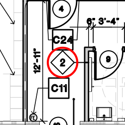 ✔
29. `PT0029` **2** — A-101 p.6 @ (623, 1376) pt · símbolo rombo · 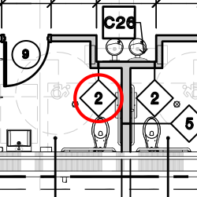 ✔
30. `PT0030` **2** — A-101 p.6 @ (657, 1376) pt · símbolo rombo · 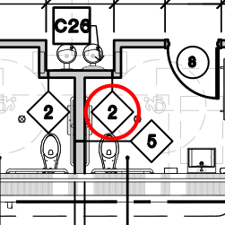 ✔
31. `PT0031` **2** — A-101 p.6 @ (740, 1376) pt · símbolo rombo · 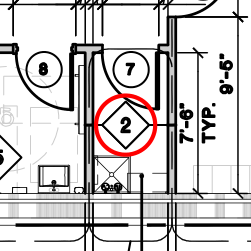 ✔
32. `PT0032` **5** — A-101 p.6 @ (678, 1391) pt · símbolo rombo · 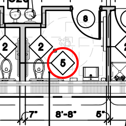 ✔
33. `PT0033` **3** — A-101 p.6 @ (1461, 1195) pt · símbolo rombo · 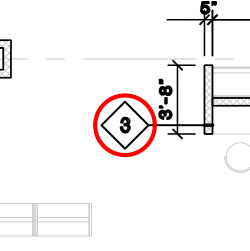 ✔
34. `PT0034` **3** — A-101 p.6 @ (1869, 1195) pt · símbolo rombo · 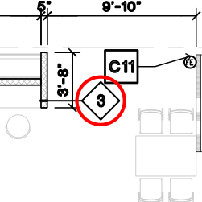 ✔
35. `PT0035` **3** — A-101 p.6 @ (1561, 1230) pt · símbolo rombo · 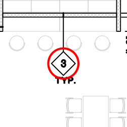 ✔
36. `PT0036` **3** — A-101 p.6 @ (1753, 1230) pt · símbolo rombo · 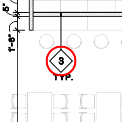 ✔
37. `PT0037` **4** — A-101 p.6 @ (1587, 855) pt · símbolo rombo · 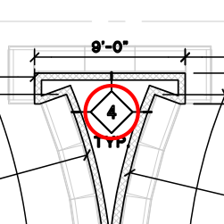 ✔
38. `PT0038` **H1** — A-221 p.15 @ (499, 396) pt · símbolo rombo · 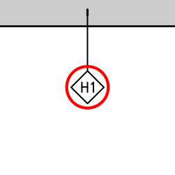 ✔
39. `PT0039` **H1** — A-221 p.15 @ (228, 601) pt · símbolo rombo · 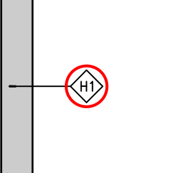 ✔
40. `PT0040` **H2a** — A-221 p.15 @ (1184, 409) pt · símbolo rombo · 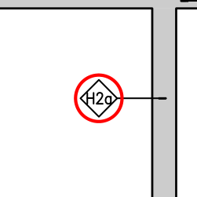 ✔
41. `PT0041` **H2b** — A-221 p.15 @ (333, 731) pt · símbolo rombo · 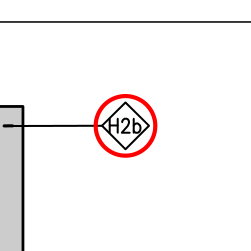 ✔
42. `PT0042` **H3a** — A-221 p.15 @ (1202, 155) pt · símbolo rombo · 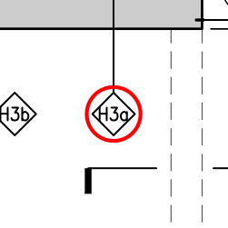 ✔
43. `PT0043` **H3b** — A-221 p.15 @ (1149, 155) pt · símbolo rombo · 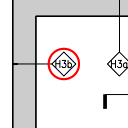 ✔
44. `PT0044` **E2** — A-221 p.15 @ (595, 748) pt · símbolo rombo · 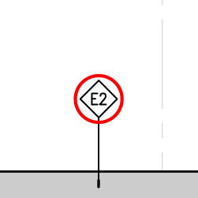 ✔
45. `PT0045` **E1** — A-221 p.15 @ (1312, 716) pt · símbolo rombo · 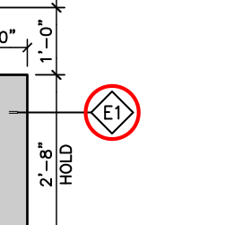 ✔
46. `PT0046` **E1** — A-221 p.15 @ (1865, 747) pt · símbolo rombo · 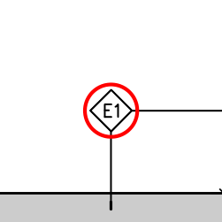 ✔
47. `PT0047` **F** — A-221 p.15 @ (2004, 749) pt · símbolo rombo · 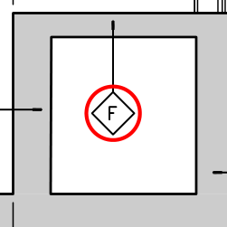 ✔
48. `PT0048` **I** — A-221 p.15 @ (1297, 105) pt · símbolo rombo · 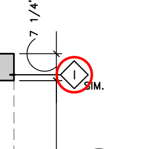 ✔
49. `PT0049` **I** — A-221 p.15 @ (1297, 349) pt · símbolo rombo · 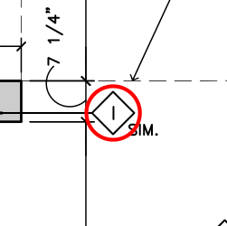 ✔
50. `PT0050` **I** — A-221 p.15 @ (1235, 636) pt · símbolo rombo ·  ✔
51. `PT0051` **I** — A-221 p.15 @ (2091, 780) pt · símbolo rombo ·  ✔
52. `PT0052` **A** — A-221 p.15 @ (1673, 421) pt · símbolo rombo ·  ✔
53. `PT0053` **A** — A-221 p.15 @ (1971, 447) pt · símbolo rombo ·  ✔
54. `PT0054` **A** — A-221 p.15 @ (1998, 579) pt · símbolo rombo ·  ✔
55. `PT0055` **B** — A-221 p.15 @ (1356, 417) pt · símbolo rombo ·  ✔
56. `PT0056` **D** — A-221 p.15 @ (1540, 516) pt · símbolo rombo ·  ✔
57. `PT0057` **C** — A-221 p.15 @ (1545, 417) pt · símbolo rombo ·  ✔

## Ambiguos — candidatos que EXIGEN disposición (v78 R78.5)

Cada `PA####` va en `tag_ids` de un wall de ese type (contado) o en `tags_descartados` {id, motivo de plano, imagen}; la compuerta (etapas.py) falla si alguno queda sin disposición.

## Tags en símbolo que NO están en el schedule (posible type faltante en el schedule → RFI)

ninguno

Cada candidato (`PC####`) entra al cruce de comparar.py / etapas.py compuerta: una lectura lo toma (wall con ese tag) o queda alerta "tag sin wall".

## Otras ocurrencias (conteo)

- partition_texto: 0
- door_window_tag: 0
- detail_bubble: 72
- detail_ref_text: 0
- keynote: 0
- cota: 634

## Hojas NO inventariables por script

- p.3 A-001: NO INVENTARIABLE POR SCRIPT: página sin texto extraíble (raster / escaneada, 4 imagen(es)); sheet number repetido en 2 páginas (se cita con página)
- p.4 A-002: NO INVENTARIABLE POR SCRIPT: página sin texto extraíble (raster / escaneada, 3 imagen(es))
- p.6 A-101: NO INVENTARIABLE POR SCRIPT: página sin texto extraíble (raster / escaneada, 2 imagen(es))
- p.7 A-111: NO INVENTARIABLE POR SCRIPT: página sin texto extraíble (raster / escaneada, 2 imagen(es))
- p.9 A-131: NO INVENTARIABLE POR SCRIPT: página sin texto extraíble (raster / escaneada, 2 imagen(es))
- p.10 A-151: NO INVENTARIABLE POR SCRIPT: página sin texto extraíble (raster / escaneada, 2 imagen(es))
- p.11 A-200: NO INVENTARIABLE POR SCRIPT: página sin texto extraíble (raster / escaneada, 84 imagen(es))
- p.13 A-210: NO INVENTARIABLE POR SCRIPT: página sin texto extraíble (raster / escaneada, 2 imagen(es))
- p.14 A-220: NO INVENTARIABLE POR SCRIPT: página sin texto extraíble (raster / escaneada, 3 imagen(es))
- p.20 A-225: NO INVENTARIABLE POR SCRIPT: página sin texto extraíble (raster / escaneada, 107 imagen(es))
- p.23 A-227: NO INVENTARIABLE POR SCRIPT: página sin texto extraíble (raster / escaneada, 2 imagen(es))
- p.24 A-228: NO INVENTARIABLE POR SCRIPT: página sin texto extraíble (raster / escaneada, 6 imagen(es))
- p.25 A-300: NO INVENTARIABLE POR SCRIPT: página sin texto extraíble (raster / escaneada, 2 imagen(es))
- p.26 (sin número): NO INVENTARIABLE POR SCRIPT: página sin texto extraíble (raster / escaneada, 2 imagen(es))
- p.27 (sin número): NO INVENTARIABLE POR SCRIPT: página sin texto extraíble (raster / escaneada, 2 imagen(es))
- p.29 A-412: NO INVENTARIABLE POR SCRIPT: página sin texto extraíble (raster / escaneada, 3 imagen(es))
- p.30 A-413: NO INVENTARIABLE POR SCRIPT: página sin texto extraíble (raster / escaneada, 3 imagen(es))
- p.32 A-500: NO INVENTARIABLE POR SCRIPT: página sin texto extraíble (raster / escaneada, 2 imagen(es))
- p.33 A-510: NO INVENTARIABLE POR SCRIPT: página sin texto extraíble (raster / escaneada, 2 imagen(es))

## Índice de hojas

| Página | Sheet | Title | Planta con tags | Nota |
|---|---|---|---|---|
| 1 | A-000 | — |  |  |
| 2 | — | — |  | sheet number NO IDENTIFICADO en el title block (puede estar vectorizado) |
| 3 | A-001 | — |  | NO INVENTARIABLE POR SCRIPT: página sin texto extraíble (raster / escaneada, 4 imagen(es)); sheet number repetido en 2 páginas (se cita con página) |
| 4 | A-002 | — |  | NO INVENTARIABLE POR SCRIPT: página sin texto extraíble (raster / escaneada, 3 imagen(es)) |
| 5 | A-003 | — |  |  |
| 6 | A-101 | — | sí | NO INVENTARIABLE POR SCRIPT: página sin texto extraíble (raster / escaneada, 2 imagen(es)) |
| 7 | A-111 | — |  | NO INVENTARIABLE POR SCRIPT: página sin texto extraíble (raster / escaneada, 2 imagen(es)) |
| 8 | A-121 | — |  |  |
| 9 | A-131 | — |  | NO INVENTARIABLE POR SCRIPT: página sin texto extraíble (raster / escaneada, 2 imagen(es)) |
| 10 | A-151 | — |  | NO INVENTARIABLE POR SCRIPT: página sin texto extraíble (raster / escaneada, 2 imagen(es)) |
| 11 | A-200 | — |  | NO INVENTARIABLE POR SCRIPT: página sin texto extraíble (raster / escaneada, 84 imagen(es)) |
| 12 | A-201 | — |  |  |
| 13 | A-210 | — |  | NO INVENTARIABLE POR SCRIPT: página sin texto extraíble (raster / escaneada, 2 imagen(es)) |
| 14 | A-220 | — |  | NO INVENTARIABLE POR SCRIPT: página sin texto extraíble (raster / escaneada, 3 imagen(es)) |
| 15 | A-221 | — | sí |  |
| 16 | — | — |  | sheet number NO IDENTIFICADO en el title block (puede estar vectorizado) |
| 17 | — | — |  | sheet number NO IDENTIFICADO en el title block (puede estar vectorizado) |
| 18 | A-223 | — |  |  |
| 19 | A-224 | — |  |  |
| 20 | A-225 | — |  | NO INVENTARIABLE POR SCRIPT: página sin texto extraíble (raster / escaneada, 107 imagen(es)) |
| 21 | — | — |  | sheet number NO IDENTIFICADO en el title block (puede estar vectorizado) |
| 22 | — | — |  | sheet number NO IDENTIFICADO en el title block (puede estar vectorizado) |
| 23 | A-227 | — |  | NO INVENTARIABLE POR SCRIPT: página sin texto extraíble (raster / escaneada, 2 imagen(es)) |
| 24 | A-228 | — |  | NO INVENTARIABLE POR SCRIPT: página sin texto extraíble (raster / escaneada, 6 imagen(es)) |
| 25 | A-300 | — |  | NO INVENTARIABLE POR SCRIPT: página sin texto extraíble (raster / escaneada, 2 imagen(es)) |
| 26 | — | — |  | NO INVENTARIABLE POR SCRIPT: página sin texto extraíble (raster / escaneada, 2 imagen(es)) |
| 27 | — | — |  | NO INVENTARIABLE POR SCRIPT: página sin texto extraíble (raster / escaneada, 2 imagen(es)) |
| 28 | A-410 | — |  |  |
| 29 | A-412 | — |  | NO INVENTARIABLE POR SCRIPT: página sin texto extraíble (raster / escaneada, 3 imagen(es)) |
| 30 | A-413 | — |  | NO INVENTARIABLE POR SCRIPT: página sin texto extraíble (raster / escaneada, 3 imagen(es)) |
| 31 | A-414 | — |  |  |
| 32 | A-500 | — |  | NO INVENTARIABLE POR SCRIPT: página sin texto extraíble (raster / escaneada, 2 imagen(es)) |
| 33 | A-510 | — |  | NO INVENTARIABLE POR SCRIPT: página sin texto extraíble (raster / escaneada, 2 imagen(es)) |
| 34 | DM-101 | — |  |  |
| 35 | — | — |  | sheet number NO IDENTIFICADO en el title block (puede estar vectorizado) |
| 36 | — | — |  | sheet number NO IDENTIFICADO en el title block (puede estar vectorizado) |
| 37 | LC2-1 | PIPED TO ABOVE CEILING WITH PULL STRING. |  |  |
| 38 | — | — |  | sheet number NO IDENTIFICADO en el title block (puede estar vectorizado) |
| 39 | L6-30P | WIRE SIZE |  |  |
| 40 | — | — |  | sheet number NO IDENTIFICADO en el title block (puede estar vectorizado) |
| 41 | — | — |  | sheet number NO IDENTIFICADO en el title block (puede estar vectorizado) |
| 42 | — | — |  | sheet number NO IDENTIFICADO en el title block (puede estar vectorizado) |
| 43 | — | — |  | sheet number NO IDENTIFICADO en el title block (puede estar vectorizado) |
| 44 | — | — |  | sheet number NO IDENTIFICADO en el title block (puede estar vectorizado) |
| 45 | — | — |  | sheet number NO IDENTIFICADO en el title block (puede estar vectorizado) |
| 46 | — | — |  | sheet number NO IDENTIFICADO en el title block (puede estar vectorizado) |
| 47 | H-20 | (E) (E) |  |  |
| 48 | — | — |  | sheet number NO IDENTIFICADO en el title block (puede estar vectorizado) |
| 49 | — | — |  | sheet number NO IDENTIFICADO en el title block (puede estar vectorizado) |
| 50 | — | — |  | sheet number NO IDENTIFICADO en el title block (puede estar vectorizado) |
| 51 | — | — |  | sheet number NO IDENTIFICADO en el title block (puede estar vectorizado) |
| 52 | — | — |  | sheet number NO IDENTIFICADO en el title block (puede estar vectorizado) |
| 53 | EWC-1 | D |  | sheet number repetido en 2 páginas (se cita con página) |
| 54 | — | — |  | sheet number NO IDENTIFICADO en el title block (puede estar vectorizado) |
| 55 | — | — |  | sheet number NO IDENTIFICADO en el title block (puede estar vectorizado) |
| 56 | EWC-1 | 17. NEW 30 GALLON  ELECTRIC WATER HEATER TANK (EWH-1). REFER TO SHEET #P-201 FOR SPECIFICATIONS. |  | sheet number repetido en 2 páginas (se cita con página) |
| 57 | BFP-1 | 1" SROCW |  |  |
| 58 | — | — |  | sheet number NO IDENTIFICADO en el title block (puede estar vectorizado) |
| 59 | — | — |  | sheet number NO IDENTIFICADO en el title block (puede estar vectorizado) |
| 60 | EWH-1 | PUMP SCHEDULE |  |  |
| 61 | — | — |  | sheet number NO IDENTIFICADO en el title block (puede estar vectorizado) |
| 62 | — | — |  | sheet number NO IDENTIFICADO en el title block (puede estar vectorizado) |
| 63 | — | — |  | sheet number NO IDENTIFICADO en el title block (puede estar vectorizado) |
| 64 | A-001 | — |  | sheet number repetido en 2 páginas (se cita con página) |
| 65 | — | — |  | sheet number NO IDENTIFICADO en el title block (puede estar vectorizado) |
| 66 | — | — |  | sheet number NO IDENTIFICADO en el title block (puede estar vectorizado) |
| 67 | — | — |  | sheet number NO IDENTIFICADO en el title block (puede estar vectorizado) |
| 68 | — | — |  | sheet number NO IDENTIFICADO en el title block (puede estar vectorizado) |
| 69 | — | — |  | sheet number NO IDENTIFICADO en el title block (puede estar vectorizado) |

## Avisos

- detail bubbles que citan una hoja que NO está en el índice (¿numeración distinta o hoja faltante? → RFI): 1/E-103 ×2, 1/E-105 ×2, 10/BFP-3 ×1, 2/AHU-1 ×1, 2/E-103 ×2, 3/E-103 ×2, 3/RTU-2 ×1, 3/RTU-6 ×1, 4/E-103 ×2, AO/DEL-20 ×1, AO/DSE-30 ×1, BE/B-120 ×1, BE/G-931 ×1, BE/SP-80 ×1, CO/RG-1 ×1, CO/SOD-24 ×1, D4/LC1-48 ×1, D6/LC1-54 ×2, EM1/LC1-22 ×1, EM1/LC1-24 ×1, HB/LC1-20 ×3, HB/LC1-22 ×3, HB/LC1-32 ×1, HB/LC1-38 ×1, HW/LAV-1 ×1, IN/A-222 ×1, J/LC1-20 ×1, J/LC1-28 ×1, J/REG-8 ×1, OR/R-10 ×1, T/AHU-1 ×2, T/CUH-1 ×1, T/RTU-1 ×1, T/RTU-2 ×1, TO/LC1-17 ×3, TO/LC1-19 ×4, TO/R-13 ×1, TS/RTU-1 ×2, TS/RTU-2 ×2, TS/RTU-3 ×2, TS/RTU-4 ×2, TS/RTU-5 ×2, TS/RTU-6 ×2, TS/RTU-7 ×1, VD1/CD-1 ×1
- Hojas de planta A-101 (p.6) y A-221 (p.15) con texto vectorizado: barrido manual de tags (rombos en vector + lectura visual, img/p6_contactos.png, img/p15_contactos.png). Rombos en p.54/57/60 (M/P) = keynotes de equipo, no partition tags.
