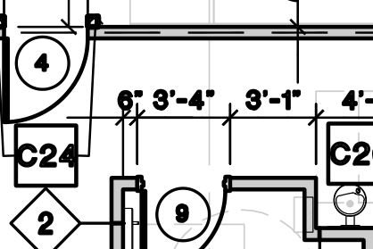
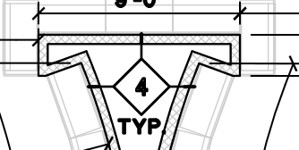
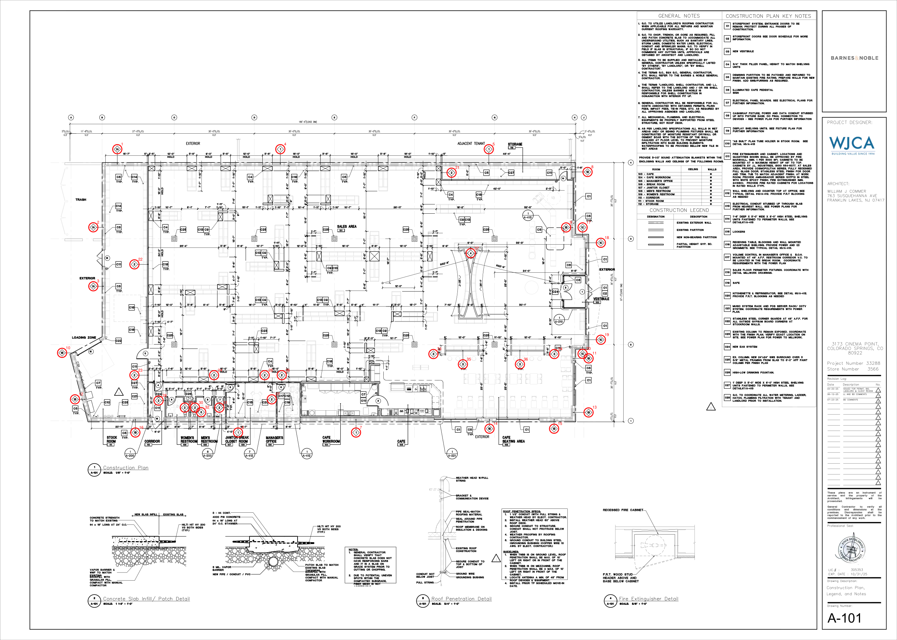
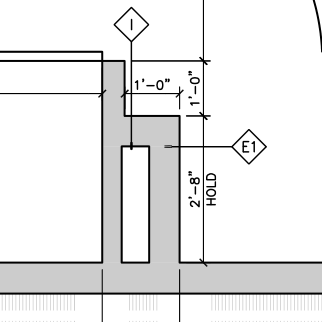

# Stage 3 resolution - Barnes & Noble Colorado Springs

Every item of revision.md is closed here: item -> decision -> N/SHEET -> image. Nothing is averaged; where both
readings are defensible the reading with the drawn evidence is taken and the other goes to an RFI with its delta.

## Decisions applied to the reconciled canon (4_canon/takeoff_canon.json)

1. **Type 2 corridor east wall W2-05 / restroom front W2-06 (review items 10, 11)** -> Reading B: W2-05 starts at the restroom front line (y=1337), 7.92 LF; W2-06 segments measured face to face with one owner per corner (R70.2 / R75.7), 25.86 LF total (= cache 25.86) · source A-101 · ΔLF vs reading A -5.82 · 
2. **Type 4 center feature caps and curved walls (review items 12-22, 28-30, 42-48)** -> Reading B: each cap is an open U (9'-0" bar + two returns + two legs into the curved walls), not a closed box; curved walls = printed 25'-1" (6 chords). RFI-18: face-average arc 25.68 LF each (+1.20 LF) · source 4/A-410 · ΔLF vs reading A -5.37 · 
3. **Exterior corners without owner (esquinas.py R70.2)** -> EXT-01, EXT-02, EXT-10, EXT-13, EXT-16 run to the outer face of the wall they meet (one owner per corner) · source A-101 · ΔLF vs reading A 3.38 · 
4. **Workroom door pier 1'-0" return (review items 23, 40, 50)** -> Reading B: the I tag (PT0050) leader lands on the 1'-0" return -> type I 1.00 LF; the E1 tag (PT0045) marks the 2'-8" HOLD pier -> E1 2.11 LF · source 1/A-221 · ΔLF vs reading A 0.0 · 

## Review items of revision.md

1. [difieren] 1A A-101: A EXT-01 15.83 LF / B B-A-101-1 49.37 LF -> Reading A kept. Storefront / curtain wall openings are OUT of the exterior LF (R70.7) - reading B measured each facade through the storefronts; solid piers agree (east 10.80, south-east 19.36, 1C 18.94 LF). Type boundaries without a drawn node -> RFI-02 (north 1A/1 +33.54 LF moves, south 1B/1 1.55 LF). Cafe south line counted once as E1/E2 -> RFI-05 (B type-1 50.24 LF behind the cafe walls). Source 1/A-410, 1A/A-410, 1B/A-410, 1C/A-410, A-101.
2. [difieren] 1 A-101: A EXT-02 158.57 LF / B B-A-101-2 125.03 LF -> Reading A kept. Storefront / curtain wall openings are OUT of the exterior LF (R70.7) - reading B measured each facade through the storefronts; solid piers agree (east 10.80, south-east 19.36, 1C 18.94 LF). Type boundaries without a drawn node -> RFI-02 (north 1A/1 +33.54 LF moves, south 1B/1 1.55 LF). Cafe south line counted once as E1/E2 -> RFI-05 (B type-1 50.24 LF behind the cafe walls). Source 1/A-410, 1A/A-410, 1B/A-410, 1C/A-410, A-101.
3. [difieren] 1 A-101: A EXT-07 56.97 LF / B B-A-101-7 105.67 LF -> Reading A kept. Storefront / curtain wall openings are OUT of the exterior LF (R70.7) - reading B measured each facade through the storefronts; solid piers agree (east 10.80, south-east 19.36, 1C 18.94 LF). Type boundaries without a drawn node -> RFI-02 (north 1A/1 +33.54 LF moves, south 1B/1 1.55 LF). Cafe south line counted once as E1/E2 -> RFI-05 (B type-1 50.24 LF behind the cafe walls). Source 1/A-410, 1A/A-410, 1B/A-410, 1C/A-410, A-101.
4. [difieren] 1B A-101: A EXT-06 21.13 LF / B B-A-101-6 22.68 LF -> Reading A kept. Storefront / curtain wall openings are OUT of the exterior LF (R70.7) - reading B measured each facade through the storefronts; solid piers agree (east 10.80, south-east 19.36, 1C 18.94 LF). Type boundaries without a drawn node -> RFI-02 (north 1A/1 +33.54 LF moves, south 1B/1 1.55 LF). Cafe south line counted once as E1/E2 -> RFI-05 (B type-1 50.24 LF behind the cafe walls). Source 1/A-410, 1A/A-410, 1B/A-410, 1C/A-410, A-101.
5. [difieren] 1B A-101: A EXT-09 7.33 LF / B B-A-101-8 51.36 LF -> Reading A kept. Storefront / curtain wall openings are OUT of the exterior LF (R70.7) - reading B measured each facade through the storefronts; solid piers agree (east 10.80, south-east 19.36, 1C 18.94 LF). Type boundaries without a drawn node -> RFI-02 (north 1A/1 +33.54 LF moves, south 1B/1 1.55 LF). Cafe south line counted once as E1/E2 -> RFI-05 (B type-1 50.24 LF behind the cafe walls). Source 1/A-410, 1A/A-410, 1B/A-410, 1C/A-410, A-101.
6. [difieren] 1B A-101: A EXT-17 6.44 LF / B B-A-101-9 26.8 LF -> Reading A kept. Storefront / curtain wall openings are OUT of the exterior LF (R70.7) - reading B measured each facade through the storefronts; solid piers agree (east 10.80, south-east 19.36, 1C 18.94 LF). Type boundaries without a drawn node -> RFI-02 (north 1A/1 +33.54 LF moves, south 1B/1 1.55 LF). Cafe south line counted once as E1/E2 -> RFI-05 (B type-1 50.24 LF behind the cafe walls). Source 1/A-410, 1A/A-410, 1B/A-410, 1C/A-410, A-101.
7. [difieren] 1B A-101: A EXT-12 6.44 LF / B B-A-101-13 26.8 LF -> Reading A kept. Storefront / curtain wall openings are OUT of the exterior LF (R70.7) - reading B measured each facade through the storefronts; solid piers agree (east 10.80, south-east 19.36, 1C 18.94 LF). Type boundaries without a drawn node -> RFI-02 (north 1A/1 +33.54 LF moves, south 1B/1 1.55 LF). Cafe south line counted once as E1/E2 -> RFI-05 (B type-1 50.24 LF behind the cafe walls). Source 1/A-410, 1A/A-410, 1B/A-410, 1C/A-410, A-101.
8. [difieren] 1C A-101: A EXT-14 4.24 LF / B B-A-101-11 40.64 LF -> Reading A kept. Storefront / curtain wall openings are OUT of the exterior LF (R70.7) - reading B measured each facade through the storefronts; solid piers agree (east 10.80, south-east 19.36, 1C 18.94 LF). Type boundaries without a drawn node -> RFI-02 (north 1A/1 +33.54 LF moves, south 1B/1 1.55 LF). Cafe south line counted once as E1/E2 -> RFI-05 (B type-1 50.24 LF behind the cafe walls). Source 1/A-410, 1A/A-410, 1B/A-410, 1C/A-410, A-101.
9. [difieren] 2 A-101: A W2-01+W2-02 53.76 LF / B B-A-101-14 5.0 LF -> See decision 1 (W2-05 / W2-06 from reading B, image res_W205.png). W2-01 kept from reading A: 48.77 = printed 48'-4" (A-101) + W2-02 thickness; B ran into the exterior wall (49.20). Source 2/A-410, A-101.
10. [difieren] 2 A-101: A W2-06.1+W2-06.2+W2-06.3+W2-06.4+W2-06.5 26.68 LF / B B-A-101-19c+B-A-101-19d+B-A-101-19e 17.55 LF -> See decision 1 (W2-05 / W2-06 from reading B, image res_W205.png). W2-01 kept from reading A: 48.77 = printed 48'-4" (A-101) + W2-02 thickness; B ran into the exterior wall (49.20). Source 2/A-410, A-101.
11. [difieren] 2 A-101: A W2-05 12.92 LF / B B-A-101-18+B-A-101-19a+B-A-101-19b 16.23 LF -> See decision 1 (W2-05 / W2-06 from reading B, image res_W205.png). W2-01 kept from reading A: 48.77 = printed 48'-4" (A-101) + W2-02 thickness; B ran into the exterior wall (49.20). Source 2/A-410, A-101.
12. [difieren] 4 A-101: A W4-04.1+W4-04.2+W4-04.3+W4-04.4 19.96 LF / B B-A-101-31a+B-A-101-31b+B-A-101-31c 11.86 LF -> See decision 2 (type 4 from reading B: open U caps, curved walls 25'-1" printed; RFI-18). Source 4/A-410, A-101.
13. [difieren] 4 A-101: A W4-01.1+W4-01.2+W4-01.3+W4-01.4 19.96 LF / B B-A-101-28a+B-A-101-28b+B-A-101-28c 11.86 LF -> See decision 2 (type 4 from reading B: open U caps, curved walls 25'-1" printed; RFI-18). Source 4/A-410, A-101.
14. [difieren] 4 A-101: A W4-02.2 4.39 LF / B B-A-101-29c 4.19 LF -> See decision 2 (type 4 from reading B: open U caps, curved walls 25'-1" printed; RFI-18). Source 4/A-410, A-101.
15. [difieren] 4 A-101: A W4-02.5 4.39 LF / B B-A-101-29d 4.19 LF -> See decision 2 (type 4 from reading B: open U caps, curved walls 25'-1" printed; RFI-18). Source 4/A-410, A-101.
16. [difieren] 4 A-101: A W4-03.2 3.96 LF / B B-A-101-29a 4.18 LF -> See decision 2 (type 4 from reading B: open U caps, curved walls 25'-1" printed; RFI-18). Source 4/A-410, A-101.
17. [difieren] 4 A-101: A W4-03.5 3.96 LF / B B-A-101-30a 4.18 LF -> See decision 2 (type 4 from reading B: open U caps, curved walls 25'-1" printed; RFI-18). Source 4/A-410, A-101.
18. [difieren] 4 A-101: A W4-03.6 3.96 LF / B B-A-101-29b 4.18 LF -> See decision 2 (type 4 from reading B: open U caps, curved walls 25'-1" printed; RFI-18). Source 4/A-410, A-101.
19. [difieren] 4 A-101: A W4-03.1 3.95 LF / B B-A-101-29e 4.18 LF -> See decision 2 (type 4 from reading B: open U caps, curved walls 25'-1" printed; RFI-18). Source 4/A-410, A-101.
20. [difieren] 4 A-101: A W4-03.3 3.95 LF / B B-A-101-30b 4.18 LF -> See decision 2 (type 4 from reading B: open U caps, curved walls 25'-1" printed; RFI-18). Source 4/A-410, A-101.
21. [difieren] 4 A-101: A W4-02.1 3.79 LF / B B-A-101-30c 4.18 LF -> See decision 2 (type 4 from reading B: open U caps, curved walls 25'-1" printed; RFI-18). Source 4/A-410, A-101.
22. [difieren] 4 A-101: A W4-02.6 3.79 LF / B B-A-101-30d 4.18 LF -> See decision 2 (type 4 from reading B: open U caps, curved walls 25'-1" printed; RFI-18). Source 4/A-410, A-101.
23. [difieren] E1 A-221: A C-E1-S+C-E1-P.2 25.57 LF / B B-A-221-9 2.11 LF -> See decision 3 (I tag PT0050 = 1'-0" return; E1 = 2'-8" pier) and type_change_rfi E2/E1 at H2a (RFI-05, 0.20 LF). Source E/A-221, I/A-221, 1/A-221.
24. [solo_A] 1B A-101: A EXT-10 12.03 LF / B - - LF -> Reading A kept. Storefront / curtain wall openings are OUT of the exterior LF (R70.7) - reading B measured each facade through the storefronts; solid piers agree (east 10.80, south-east 19.36, 1C 18.94 LF). Type boundaries without a drawn node -> RFI-02 (north 1A/1 +33.54 LF moves, south 1B/1 1.55 LF). Cafe south line counted once as E1/E2 -> RFI-05 (B type-1 50.24 LF behind the cafe walls). Source 1/A-410, 1A/A-410, 1B/A-410, 1C/A-410, A-101.
25. [solo_A] 1B A-101: A EXT-11 4.36 LF / B - - LF -> Reading A kept. Storefront / curtain wall openings are OUT of the exterior LF (R70.7) - reading B measured each facade through the storefronts; solid piers agree (east 10.80, south-east 19.36, 1C 18.94 LF). Type boundaries without a drawn node -> RFI-02 (north 1A/1 +33.54 LF moves, south 1B/1 1.55 LF). Cafe south line counted once as E1/E2 -> RFI-05 (B type-1 50.24 LF behind the cafe walls). Source 1/A-410, 1A/A-410, 1B/A-410, 1C/A-410, A-101.
26. [solo_A] 1B A-101: A EXT-18 4.36 LF / B - - LF -> Reading A kept. Storefront / curtain wall openings are OUT of the exterior LF (R70.7) - reading B measured each facade through the storefronts; solid piers agree (east 10.80, south-east 19.36, 1C 18.94 LF). Type boundaries without a drawn node -> RFI-02 (north 1A/1 +33.54 LF moves, south 1B/1 1.55 LF). Cafe south line counted once as E1/E2 -> RFI-05 (B type-1 50.24 LF behind the cafe walls). Source 1/A-410, 1A/A-410, 1B/A-410, 1C/A-410, A-101.
27. [solo_A] 1C A-101: A EXT-15 4.24 LF / B - - LF -> Reading A kept. Storefront / curtain wall openings are OUT of the exterior LF (R70.7) - reading B measured each facade through the storefronts; solid piers agree (east 10.80, south-east 19.36, 1C 18.94 LF). Type boundaries without a drawn node -> RFI-02 (north 1A/1 +33.54 LF moves, south 1B/1 1.55 LF). Cafe south line counted once as E1/E2 -> RFI-05 (B type-1 50.24 LF behind the cafe walls). Source 1/A-410, 1A/A-410, 1B/A-410, 1C/A-410, A-101.
28. [solo_A] 4 A-101: A W4-02.3 3.75 LF / B - - LF -> See decision 2 (type 4 from reading B: open U caps, curved walls 25'-1" printed; RFI-18). Source 4/A-410, A-101.
29. [solo_A] 4 A-101: A W4-02.4 3.75 LF / B - - LF -> See decision 2 (type 4 from reading B: open U caps, curved walls 25'-1" printed; RFI-18). Source 4/A-410, A-101.
30. [solo_A] 4 A-101: A W4-03.4 2.64 LF / B - - LF -> See decision 2 (type 4 from reading B: open U caps, curved walls 25'-1" printed; RFI-18). Source 4/A-410, A-101.
31. [solo_A]  A-101: A CW-01 8.0 LF / B - - LF -> Key note C25 column surrounds (A-101): not partition tags; reading A counted 9 (9 C25 boxes + 9 hatched column symbols, img_cache/keynotes_contactos.png); reading B mentioned 10 without measuring -> Review item. OTHER FRAMING (column_wrap).
32. [solo_A]  A-101: A CW-02 8.0 LF / B - - LF -> Key note C25 column surrounds (A-101): not partition tags; reading A counted 9 (9 C25 boxes + 9 hatched column symbols, img_cache/keynotes_contactos.png); reading B mentioned 10 without measuring -> Review item. OTHER FRAMING (column_wrap).
33. [solo_A]  A-101: A CW-03 8.0 LF / B - - LF -> Key note C25 column surrounds (A-101): not partition tags; reading A counted 9 (9 C25 boxes + 9 hatched column symbols, img_cache/keynotes_contactos.png); reading B mentioned 10 without measuring -> Review item. OTHER FRAMING (column_wrap).
34. [solo_A]  A-101: A CW-04 8.0 LF / B - - LF -> Key note C25 column surrounds (A-101): not partition tags; reading A counted 9 (9 C25 boxes + 9 hatched column symbols, img_cache/keynotes_contactos.png); reading B mentioned 10 without measuring -> Review item. OTHER FRAMING (column_wrap).
35. [solo_A]  A-101: A CW-05 8.0 LF / B - - LF -> Key note C25 column surrounds (A-101): not partition tags; reading A counted 9 (9 C25 boxes + 9 hatched column symbols, img_cache/keynotes_contactos.png); reading B mentioned 10 without measuring -> Review item. OTHER FRAMING (column_wrap).
36. [solo_A]  A-101: A CW-06 8.0 LF / B - - LF -> Key note C25 column surrounds (A-101): not partition tags; reading A counted 9 (9 C25 boxes + 9 hatched column symbols, img_cache/keynotes_contactos.png); reading B mentioned 10 without measuring -> Review item. OTHER FRAMING (column_wrap).
37. [solo_A]  A-101: A CW-07 8.0 LF / B - - LF -> Key note C25 column surrounds (A-101): not partition tags; reading A counted 9 (9 C25 boxes + 9 hatched column symbols, img_cache/keynotes_contactos.png); reading B mentioned 10 without measuring -> Review item. OTHER FRAMING (column_wrap).
38. [solo_A]  A-101: A CW-08 8.0 LF / B - - LF -> Key note C25 column surrounds (A-101): not partition tags; reading A counted 9 (9 C25 boxes + 9 hatched column symbols, img_cache/keynotes_contactos.png); reading B mentioned 10 without measuring -> Review item. OTHER FRAMING (column_wrap).
39. [solo_A]  A-101: A CW-09 8.0 LF / B - - LF -> Key note C25 column surrounds (A-101): not partition tags; reading A counted 9 (9 C25 boxes + 9 hatched column symbols, img_cache/keynotes_contactos.png); reading B mentioned 10 without measuring -> Review item. OTHER FRAMING (column_wrap).
40. [solo_A] E1 A-221: A C-E1-P.1 1.0 LF / B - - LF -> See decision 3 (I tag PT0050 = 1'-0" return; E1 = 2'-8" pier) and type_change_rfi E2/E1 at H2a (RFI-05, 0.20 LF). Source E/A-221, I/A-221, 1/A-221.
41. [solo_B] 2 A-101: A - - LF / B B-A-101-15 49.2 LF -> See decision 1 (W2-05 / W2-06 from reading B, image res_W205.png). W2-01 kept from reading A: 48.77 = printed 48'-4" (A-101) + W2-02 thickness; B ran into the exterior wall (49.20). Source 2/A-410, A-101.
42. [solo_B] 4 A-101: A - - LF / B B-A-101-28d 1.77 LF -> See decision 2 (type 4 from reading B: open U caps, curved walls 25'-1" printed; RFI-18). Source 4/A-410, A-101.
43. [solo_B] 4 A-101: A - - LF / B B-A-101-28e 1.72 LF -> See decision 2 (type 4 from reading B: open U caps, curved walls 25'-1" printed; RFI-18). Source 4/A-410, A-101.
44. [solo_B] 4 A-101: A - - LF / B B-A-101-29f 4.19 LF -> See decision 2 (type 4 from reading B: open U caps, curved walls 25'-1" printed; RFI-18). Source 4/A-410, A-101.
45. [solo_B] 4 A-101: A - - LF / B B-A-101-30e 4.18 LF -> See decision 2 (type 4 from reading B: open U caps, curved walls 25'-1" printed; RFI-18). Source 4/A-410, A-101.
46. [solo_B] 4 A-101: A - - LF / B B-A-101-30f 4.18 LF -> See decision 2 (type 4 from reading B: open U caps, curved walls 25'-1" printed; RFI-18). Source 4/A-410, A-101.
47. [solo_B] 4 A-101: A - - LF / B B-A-101-31d 1.75 LF -> See decision 2 (type 4 from reading B: open U caps, curved walls 25'-1" printed; RFI-18). Source 4/A-410, A-101.
48. [solo_B] 4 A-101: A - - LF / B B-A-101-31e 1.68 LF -> See decision 2 (type 4 from reading B: open U caps, curved walls 25'-1" printed; RFI-18). Source 4/A-410, A-101.
49. [solo_B] E1 A-221: A - - LF / B B-A-221-8 23.67 LF -> See decision 3 (I tag PT0050 = 1'-0" return; E1 = 2'-8" pier) and type_change_rfi E2/E1 at H2a (RFI-05, 0.20 LF). Source E/A-221, I/A-221, 1/A-221.
50. [solo_B] I A-221: A - - LF / B B-A-221-10 1.0 LF -> See decision 3 (I tag PT0050 = 1'-0" return; E1 = 2'-8" pier) and type_change_rfi E2/E1 at H2a (RFI-05, 0.20 LF). Source E/A-221, I/A-221, 1/A-221.

## Alerts

- tag sin wall I PT0048: Discarded with plan reason: "I (SIM.)" tag points to the exposed end face of a wall (finish callout, I/A-221), not a wall line; image 1_inventario/recortes/PT0048_I_A-221_p15.png. Both readings agree.
- tag sin wall I PT0049: Discarded with plan reason: "I (SIM.)" tag points to the exposed end face of a wall (finish callout, I/A-221), not a wall line; image 1_inventario/recortes/PT0049_I_A-221_p15.png. Both readings agree.
- type no inventariado  : Column surrounds C25 (OTHER FRAMING, no partition type) - see C25 above.
