# Double-reading review — canon_A.json vs canon_B.json

Inventory: inventario.json · partition rule: **eje** · match tolerance: 2 % of LF · tag-to-wall radius: 5.0 ft

## Matching walls (one line per type)

- **1A**: 1 walls match · A 2 walls / 80.61 LF · B 2 walls / 114.14 LF · inventory tags 3
- **1**: 0 walls match · A 2 walls / 215.54 LF · B 2 walls / 230.7 LF · inventory tags 4
- **1B**: 2 walls match · A 9 walls / 98.96 LF · B 6 walls / 164.51 LF · inventory tags 9
- **1C**: 2 walls match · A 4 walls / 18.94 LF · B 3 walls / 51.1 LF · inventory tags 4
- **2**: 5 walls match · A 8 walls / 277.71 LF · B 9 walls / 272.32 LF · inventory tags 11
- **5**: 1 walls match · A 1 walls / 5.7 LF · B 1 walls / 5.69 LF · inventory tags 1
- **3**: 6 walls match · A 6 walls / 38.68 LF · B 6 walls / 38.68 LF · inventory tags 4
- **4**: 0 walls match · A 14 walls / 86.2 LF · B 18 walls / 80.83 LF · inventory tags 1
- ****: 0 walls match · A 9 walls / 72.0 LF · B 0 walls / 0 LF · inventory tags 0
- **H1**: 2 walls match · A 2 walls / 42.15 LF · B 2 walls / 42.15 LF · inventory tags 2
- **H2A**: 1 walls match · A 1 walls / 12.17 LF · B 1 walls / 12.17 LF · inventory tags 1
- **H2B**: 1 walls match · A 1 walls / 1.95 LF · B 1 walls / 1.95 LF · inventory tags 1
- **H3A**: 1 walls match · A 1 walls / 4.08 LF · B 1 walls / 4.08 LF · inventory tags 1
- **H3B**: 1 walls match · A 1 walls / 6.17 LF · B 1 walls / 6.17 LF · inventory tags 1
- **E2**: 1 walls match · A 1 walls / 29.3 LF · B 1 walls / 29.1 LF · inventory tags 1
- **E1**: 1 walls match · A 3 walls / 28.88 LF · B 3 walls / 28.09 LF · inventory tags 2
- **F**: 1 walls match · A 1 walls / 3.26 LF · B 1 walls / 3.26 LF · inventory tags 1
- **I**: 1 walls match · A 1 walls / 2.31 LF · B 2 walls / 3.31 LF · inventory tags 4
- **A**: 3 walls match · A 3 walls / 20.27 LF · B 3 walls / 20.26 LF · inventory tags 3
- **B**: 1 walls match · A 1 walls / 3.17 LF · B 1 walls / 3.17 LF · inventory tags 1
- **D**: 1 walls match · A 1 walls / 5.14 LF · B 1 walls / 5.14 LF · inventory tags 1
- **C**: 1 walls match · A 1 walls / 3.17 LF · B 1 walls / 3.17 LF · inventory tags 1

## Items to review

1. **1A** — Sheet A-101 (p.6) — LF differs +33.54 LF (67.9 %): A EXT-01 15.83 LF vs B B-A-101-1 49.37 LF [matched by position] — 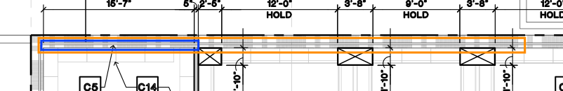
2. **1** — Sheet A-101 (p.6) — LF differs -33.54 LF (21.1 %): A EXT-02 158.57 LF vs B B-A-101-2 125.03 LF [matched by position] — 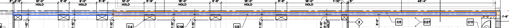
3. **1** — Sheet A-101 (p.6) — LF differs +48.70 LF (46.1 %): A EXT-07 56.97 LF vs B B-A-101-7 105.67 LF [matched by position] — 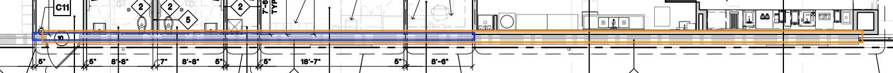
4. **1B** — Sheet A-101 (p.6) — LF differs +1.55 LF (6.8 %): A EXT-06 21.13 LF vs B B-A-101-6 22.68 LF [matched by position] — 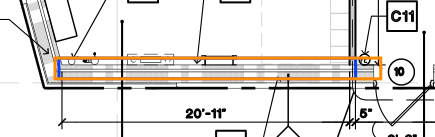 (IMAGE NOT VERIFIED)
5. **1B** — Sheet A-101 (p.6) — LF differs +44.03 LF (85.7 %): A EXT-09 7.33 LF vs B B-A-101-8 51.36 LF [matched by position] — 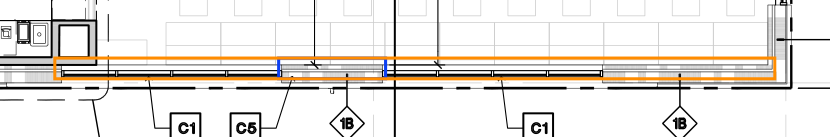 (IMAGE NOT VERIFIED)
6. **1B** — Sheet A-101 (p.6) — LF differs +20.36 LF (76.0 %): A EXT-17 6.44 LF vs B B-A-101-9 26.80 LF [matched by position] — 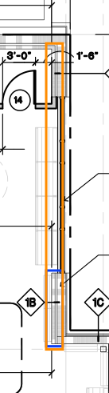 (IMAGE NOT VERIFIED)
7. **1B** — Sheet A-101 (p.6) — LF differs +20.36 LF (76.0 %): A EXT-12 6.44 LF vs B B-A-101-13 26.80 LF [matched by position] — 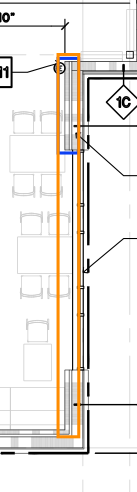 (IMAGE NOT VERIFIED)
8. **1C** — Sheet A-101 (p.6) — LF differs +36.40 LF (89.6 %): A EXT-14 4.24 LF vs B B-A-101-11 40.64 LF [matched by position] — 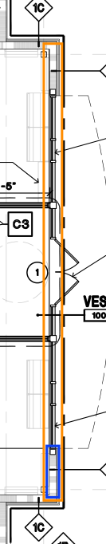
9. **2** — Sheet A-101 (p.6) — LF differs -48.76 LF (90.7 %): A W2-01+W2-02 53.76 LF (2 straight segments) vs B B-A-101-14 5.00 LF [matched by position] — 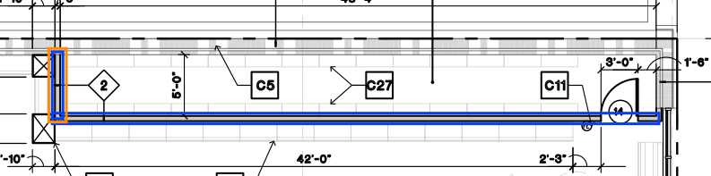
10. **2** — Sheet A-101 (p.6) — LF differs -9.13 LF (34.2 %): A W2-06.1+W2-06.2+W2-06.3+W2-06.4+W2-06.5 26.68 LF (5 straight segments) vs B B-A-101-19c+B-A-101-19d+B-A-101-19e 17.55 LF (3 straight segments) [matched by position] — 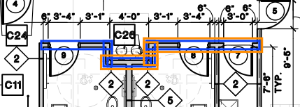
11. **2** — Sheet A-101 (p.6) — LF differs +3.31 LF (20.4 %): A W2-05 12.92 LF vs B B-A-101-18+B-A-101-19a+B-A-101-19b 16.23 LF (3 straight segments) [matched by position] — 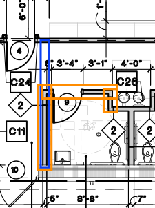
12. **4** — Sheet A-101 (p.6) — LF differs -8.10 LF (40.6 %): A W4-04.1+W4-04.2+W4-04.3+W4-04.4 19.96 LF (4 straight segments) vs B B-A-101-31a+B-A-101-31b+B-A-101-31c 11.86 LF (3 straight segments) [matched by position] — 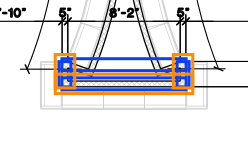
13. **4** — Sheet A-101 (p.6) — LF differs -8.10 LF (40.6 %): A W4-01.1+W4-01.2+W4-01.3+W4-01.4 19.96 LF (4 straight segments) vs B B-A-101-28a+B-A-101-28b+B-A-101-28c 11.86 LF (3 straight segments) [matched by position] — 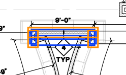
14. **4** — Sheet A-101 (p.6) — LF differs -0.20 LF (4.6 %): A W4-02.2 4.39 LF vs B B-A-101-29c 4.19 LF [matched by LF only (no geometry)] — no image: no page or no geometry
15. **4** — Sheet A-101 (p.6) — LF differs -0.20 LF (4.6 %): A W4-02.5 4.39 LF vs B B-A-101-29d 4.19 LF [matched by LF only (no geometry)] — no image: no page or no geometry
16. **4** — Sheet A-101 (p.6) — LF differs +0.22 LF (5.3 %): A W4-03.2 3.96 LF vs B B-A-101-29a 4.18 LF [matched by LF only (no geometry)] — no image: no page or no geometry
17. **4** — Sheet A-101 (p.6) — LF differs +0.22 LF (5.3 %): A W4-03.5 3.96 LF vs B B-A-101-30a 4.18 LF [matched by LF only (no geometry)] — no image: no page or no geometry
18. **4** — Sheet A-101 (p.6) — LF differs +0.22 LF (5.3 %): A W4-03.6 3.96 LF vs B B-A-101-29b 4.18 LF [matched by LF only (no geometry)] — no image: no page or no geometry
19. **4** — Sheet A-101 (p.6) — LF differs +0.23 LF (5.5 %): A W4-03.1 3.95 LF vs B B-A-101-29e 4.18 LF [matched by LF only (no geometry)] — no image: no page or no geometry
20. **4** — Sheet A-101 (p.6) — LF differs +0.23 LF (5.5 %): A W4-03.3 3.95 LF vs B B-A-101-30b 4.18 LF [matched by LF only (no geometry)] — no image: no page or no geometry
21. **4** — Sheet A-101 (p.6) — LF differs +0.39 LF (9.3 %): A W4-02.1 3.79 LF vs B B-A-101-30c 4.18 LF [matched by LF only (no geometry)] — no image: no page or no geometry
22. **4** — Sheet A-101 (p.6) — LF differs +0.39 LF (9.3 %): A W4-02.6 3.79 LF vs B B-A-101-30d 4.18 LF [matched by LF only (no geometry)] — no image: no page or no geometry
23. **E1** — Sheet A-221 (p.15) — LF differs -23.46 LF (91.8 %): A C-E1-S+C-E1-P.2 25.57 LF (2 straight segments) vs B B-A-221-9 2.11 LF [matched by position] — 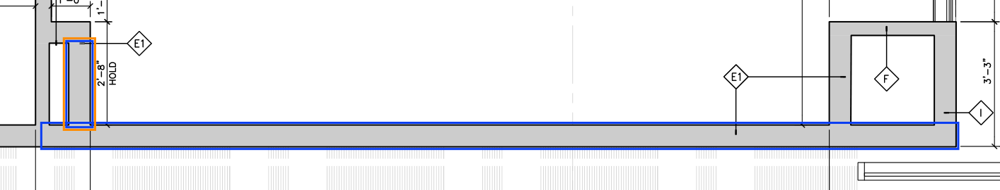
24. **1B** — Sheet A-101 (p.6) — only in reading A: EXT-10 12.03 LF — 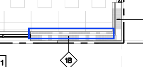
25. **1B** — Sheet A-101 (p.6) — only in reading A: EXT-11 4.36 LF — 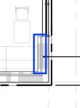
26. **1B** — Sheet A-101 (p.6) — only in reading A: EXT-18 4.36 LF — 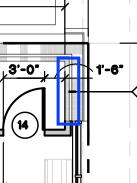
27. **1C** — Sheet A-101 (p.6) — only in reading A: EXT-15 4.24 LF — 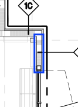
28. **4** — Sheet A-101 (p.6) — only in reading A: W4-02.3 3.75 LF — no image: no page or no geometry
29. **4** — Sheet A-101 (p.6) — only in reading A: W4-02.4 3.75 LF — no image: no page or no geometry
30. **4** — Sheet A-101 (p.6) — only in reading A: W4-03.4 2.64 LF — no image: no page or no geometry
31. **** — Sheet A-101 (p.6) — only in reading A: CW-01 8.00 LF — no image: no page or no geometry
32. **** — Sheet A-101 (p.6) — only in reading A: CW-02 8.00 LF — no image: no page or no geometry
33. **** — Sheet A-101 (p.6) — only in reading A: CW-03 8.00 LF — no image: no page or no geometry
34. **** — Sheet A-101 (p.6) — only in reading A: CW-04 8.00 LF — no image: no page or no geometry
35. **** — Sheet A-101 (p.6) — only in reading A: CW-05 8.00 LF — no image: no page or no geometry
36. **** — Sheet A-101 (p.6) — only in reading A: CW-06 8.00 LF — no image: no page or no geometry
37. **** — Sheet A-101 (p.6) — only in reading A: CW-07 8.00 LF — no image: no page or no geometry
38. **** — Sheet A-101 (p.6) — only in reading A: CW-08 8.00 LF — no image: no page or no geometry
39. **** — Sheet A-101 (p.6) — only in reading A: CW-09 8.00 LF — no image: no page or no geometry
40. **E1** — Sheet A-221 (p.15) — only in reading A: C-E1-P.1 1.00 LF — 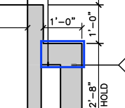
41. **2** — Sheet A-101 (p.6) — only in reading B: B-A-101-15 49.20 LF — 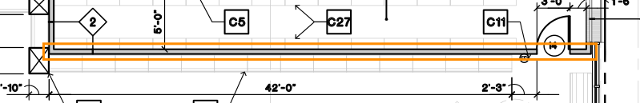
42. **4** — Sheet A-101 (p.6) — only in reading B: B-A-101-28d 1.77 LF — no image: no page or no geometry
43. **4** — Sheet A-101 (p.6) — only in reading B: B-A-101-28e 1.72 LF — no image: no page or no geometry
44. **4** — Sheet A-101 (p.6) — only in reading B: B-A-101-29f 4.19 LF — no image: no page or no geometry
45. **4** — Sheet A-101 (p.6) — only in reading B: B-A-101-30e 4.18 LF — no image: no page or no geometry
46. **4** — Sheet A-101 (p.6) — only in reading B: B-A-101-30f 4.18 LF — no image: no page or no geometry
47. **4** — Sheet A-101 (p.6) — only in reading B: B-A-101-31d 1.75 LF — no image: no page or no geometry
48. **4** — Sheet A-101 (p.6) — only in reading B: B-A-101-31e 1.68 LF — no image: no page or no geometry
49. **E1** — Sheet A-221 (p.15) — only in reading B: B-A-221-8 23.67 LF — 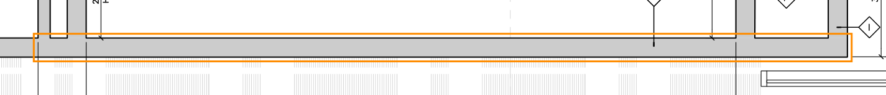
50. **I** — Sheet A-221 (p.15) — only in reading B: B-A-221-10 1.00 LF — 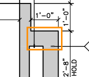

## Alerts (inventory cross-check)

1. **TAG SIN WALL** — I — Sheet A-221 (p.15): tag PT0048 I has no wall of its type within 5.0 ft in reading A nor B — 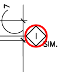
2. **TAG SIN WALL** — I — Sheet A-221 (p.15): tag PT0049 I has no wall of its type within 5.0 ft in reading A nor B — 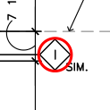
3. **TYPE NO INVENTARIADO** —  — Sheet A-101 (p.6): reading A uses type  — not a schedule type (exterior / other framing / typo?) — no image: no page or no geometry

## Notes

- A: EXT-04 (1B, A-101) sin band H|V (ori D): wall propio, no se puede unir
- A: EXT-05 (1B, A-101) sin band H|V (ori D): wall propio, no se puede unir
- A: W4-02.1 (4, A-101) sin band H|V (ori D): wall propio, no se puede unir
- A: W4-02.2 (4, A-101) sin band H|V (ori D): wall propio, no se puede unir
- A: W4-02.3 (4, A-101) sin band H|V (ori D): wall propio, no se puede unir
- A: W4-02.4 (4, A-101) sin band H|V (ori D): wall propio, no se puede unir
- A: W4-02.5 (4, A-101) sin band H|V (ori D): wall propio, no se puede unir
- A: W4-02.6 (4, A-101) sin band H|V (ori D): wall propio, no se puede unir
- A: W4-03.1 (4, A-101) sin band H|V (ori D): wall propio, no se puede unir
- A: W4-03.2 (4, A-101) sin band H|V (ori D): wall propio, no se puede unir
- A: W4-03.3 (4, A-101) sin band H|V (ori D): wall propio, no se puede unir
- A: W4-03.4 (4, A-101) sin band H|V (ori D): wall propio, no se puede unir
- A: W4-03.5 (4, A-101) sin band H|V (ori D): wall propio, no se puede unir
- A: W4-03.6 (4, A-101) sin band H|V (ori D): wall propio, no se puede unir
- A: CW-01 (, A-101) sin band H|V (ori BOX): wall propio, no se puede unir
- A: CW-02 (, A-101) sin band H|V (ori BOX): wall propio, no se puede unir
- A: CW-03 (, A-101) sin band H|V (ori BOX): wall propio, no se puede unir
- A: CW-04 (, A-101) sin band H|V (ori BOX): wall propio, no se puede unir
- A: CW-05 (, A-101) sin band H|V (ori BOX): wall propio, no se puede unir
- A: CW-06 (, A-101) sin band H|V (ori BOX): wall propio, no se puede unir
- A: CW-07 (, A-101) sin band H|V (ori BOX): wall propio, no se puede unir
- A: CW-08 (, A-101) sin band H|V (ori BOX): wall propio, no se puede unir
- A: CW-09 (, A-101) sin band H|V (ori BOX): wall propio, no se puede unir
- A:  (A-101): ningún segmento trae tag_ids; corte en cada esquina (regla 1 de eje), returns / jogs <= 1.0 ft se suman al tramo que tocan
- A: C-A-2 (A, A-221) sin band H|V (ori D): wall propio, no se puede unir
- B: B-A-101-4 (1B, A-101) sin band H|V (ori D): wall propio, no se puede unir
- B: B-A-101-5 (1B, A-101) sin band H|V (ori D): wall propio, no se puede unir
- B: B-A-101-28d (4, A-101) sin band H|V (ori D): wall propio, no se puede unir
- B: B-A-101-28e (4, A-101) sin band H|V (ori D): wall propio, no se puede unir
- B: B-A-101-29a (4, A-101) sin band H|V (ori D): wall propio, no se puede unir
- B: B-A-101-29b (4, A-101) sin band H|V (ori D): wall propio, no se puede unir
- B: B-A-101-29c (4, A-101) sin band H|V (ori D): wall propio, no se puede unir
- B: B-A-101-29d (4, A-101) sin band H|V (ori D): wall propio, no se puede unir
- B: B-A-101-29e (4, A-101) sin band H|V (ori D): wall propio, no se puede unir
- B: B-A-101-29f (4, A-101) sin band H|V (ori D): wall propio, no se puede unir
- B: B-A-101-30a (4, A-101) sin band H|V (ori D): wall propio, no se puede unir
- B: B-A-101-30b (4, A-101) sin band H|V (ori D): wall propio, no se puede unir
- B: B-A-101-30c (4, A-101) sin band H|V (ori D): wall propio, no se puede unir
- B: B-A-101-30d (4, A-101) sin band H|V (ori D): wall propio, no se puede unir
- B: B-A-101-30e (4, A-101) sin band H|V (ori D): wall propio, no se puede unir
- B: B-A-101-30f (4, A-101) sin band H|V (ori D): wall propio, no se puede unir
- B: B-A-101-31d (4, A-101) sin band H|V (ori D): wall propio, no se puede unir
- B: B-A-101-31e (4, A-101) sin band H|V (ori D): wall propio, no se puede unir
- B: B-A-221-15 (A, A-221) sin band H|V (ori D): wall propio, no se puede unir
- 004_DIF_1B_A-101_p6.png: un color esperado no aparece en su lugar
- 005_DIF_1B_A-101_p6.png: un color esperado no aparece en su lugar
- 006_DIF_1B_A-101_p6.png: un color esperado no aparece en su lugar
- 007_DIF_1B_A-101_p6.png: un color esperado no aparece en su lugar

Legend: blue = reading A, orange = reading B, red circle = inventory tag.
