# Double-reading review — canon_A.json vs canon_B.json

Inventory: inventario.json · partition rule: **eje** · match tolerance: 2 % of LF · tag-to-wall radius: 5.0 ft

## Matching walls (one line per type)

- **S21**: 6 walls match · A 6 walls / 250.71 LF · B 6 walls / 250.06 LF · inventory tags 0
- **S24**: 1 walls match · A 3 walls / 35.67 LF · B 4 walls / 34.47 LF · inventory tags 0
- **S43**: 1 walls match · A 5 walls / 53.58 LF · B 6 walls / 51.16 LF · inventory tags 0
- **S61**: 1 walls match · A 1 walls / 8.5 LF · B 1 walls / 8.64 LF · inventory tags 0
- **S41**: 0 walls match · A 4 walls / 6.46 LF · B 4 walls / 6.22 LF · inventory tags 0
- **S42**: 1 walls match · A 2 walls / 122.61 LF · B 2 walls / 115.91 LF · inventory tags 0
- ****: 0 walls match · A 6 walls / 157.91 LF · B 0 walls / 0 LF · inventory tags 0
- **EXT-8CFMF**: 0 walls match · A 0 walls / 0 LF · B 2 walls / 12.0 LF · inventory tags 0
- **EXT-6CFMF**: 0 walls match · A 0 walls / 0 LF · B 3 walls / 48.0 LF · inventory tags 0

## Items to review

1. **S24** — Sheet A1.1 (p.37) — LF differs -0.29 LF (3.4 %): A S24-RR104S 8.50 LF vs B S24-4 8.21 LF [matched by position] — 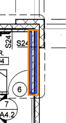
2. **S24** — Sheet A1.1 (p.37) — LF differs -8.49 LF (52.5 %): A S24-RR 16.17 LF vs B S24-2 7.68 LF [matched by position] — 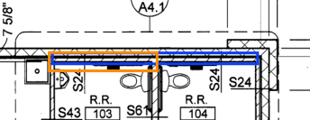
3. **S43** — Sheet A1.1 (p.37) — LF differs -8.49 LF (52.5 %): A S43-RR-S 16.17 LF vs B S43-5 7.68 LF [matched by position] — 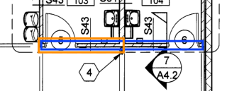
4. **S43** — Sheet A1.1 (p.37) — LF differs -0.47 LF (5.1 %): A S43-RR103-W 9.11 LF vs B S43-4 8.64 LF [matched by position] — 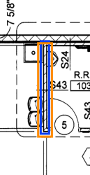
5. **S43** — Sheet A1.1 (p.37) — LF differs -0.51 LF (5.9 %): A S43-OFF-W 8.64 LF vs B S43-1 8.13 LF [matched by position] — 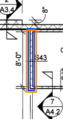
6. **S43** — Sheet A1.1 (p.37) — LF differs -0.53 LF (6.2 %): A S43-OFF-E 8.66 LF vs B S43-2 8.13 LF [matched by position] — 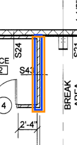
7. **S41** — Sheet A1.1 (p.37) — LF differs +0.36 LF (21.4 %): A S41-B-H 1.31 LF vs B S41-2 1.67 LF [matched by position] — 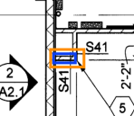
8. **S41** — Sheet A1.1 (p.37) — LF differs +0.36 LF (21.4 %): A S41-C-H 1.31 LF vs B S41-3 1.67 LF [matched by position] — 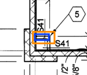
9. **S41** — Sheet A1.1 (p.37) — LF differs -0.52 LF (31.0 %): A S41-C-V 1.67 LF vs B S41-4 1.15 LF [matched by position] — 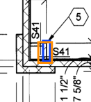
10. **S41** — Sheet A1.1 (p.37) — LF differs -0.44 LF (20.2 %): A S41-B-V 2.17 LF vs B S41-1 1.73 LF [matched by position] — 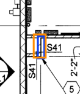
11. **S42** — Sheet A1.1 (p.37) — LF differs -6.70 LF (10.4 %): A S42-H1+S42-H2 64.11 LF vs B S42-B1+S42-B2 57.41 LF [matched by position] — 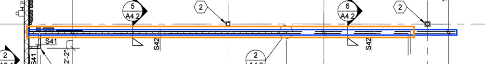
12. **** — Sheet A1.1 (p.37) — only in reading A: EXT-PIER-L-8+EXT-HEAD-8+EXT-PIER-R-8 50.67 LF — 
13. **** — Sheet A1.1 (p.37) — only in reading A: EXT-PIER-L-6+EXT-HEAD-6+EXT-PIER-R-6 50.67 LF — 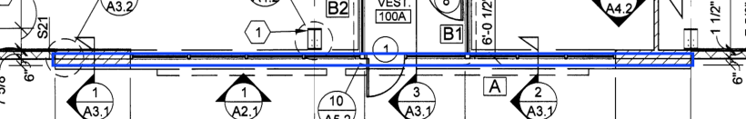
14. **** — Sheet A1.1 (p.37) — only in reading A: EXT-SOUTH-BAND 36.00 LF — 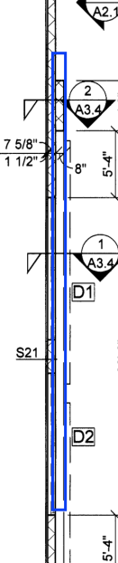
15. **** — Sheet A1.1 (p.37) — only in reading A: VEST-HD-C 8.49 LF — 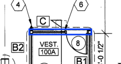
16. **** — Sheet A1.1 (p.37) — only in reading A: VEST-HD-B2 6.04 LF — 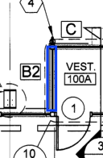
17. **** — Sheet A1.1 (p.37) — only in reading A: VEST-HD-B1 6.04 LF — 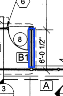
18. **S24** — Sheet A1.1 (p.37) — only in reading B: S24-3 7.73 LF — 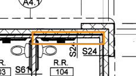
19. **S43** — Sheet A1.1 (p.37) — only in reading B: S43-6 7.73 LF — 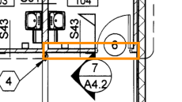
20. **EXT-8CFMF** — Sheet A1.1 (p.37) — only in reading B: EXT-WN-8 6.00 LF — 
21. **EXT-8CFMF** — Sheet A1.1 (p.37) — only in reading B: EXT-WS-8 6.00 LF — 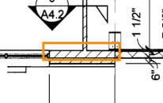
22. **EXT-6CFMF** — Sheet A1.1 (p.37) — only in reading B: EXT-WN-6 6.00 LF — 
23. **EXT-6CFMF** — Sheet A1.1 (p.37) — only in reading B: EXT-WS-6 6.00 LF — 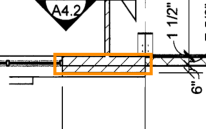
24. **EXT-6CFMF** — Sheet A1.1 (p.37) — only in reading B: EXT-S-6 36.00 LF — 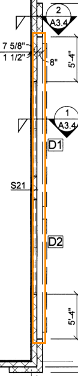

## Alerts (inventory cross-check)

1. **TYPE NO INVENTARIADO** — S21 — Sheet A1.1 (p.37): reading A uses type S21 — not a schedule type (exterior / other framing / typo?) — 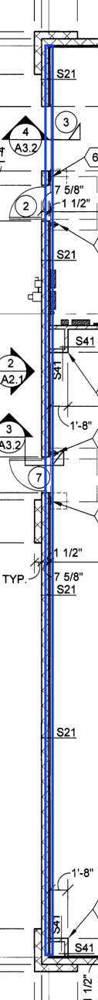
2. **TYPE NO INVENTARIADO** — S24 — Sheet A1.1 (p.37): reading A uses type S24 — not a schedule type (exterior / other framing / typo?) — 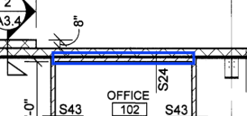
3. **TYPE NO INVENTARIADO** — S43 — Sheet A1.1 (p.37): reading A uses type S43 — not a schedule type (exterior / other framing / typo?) — 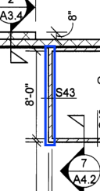
4. **TYPE NO INVENTARIADO** — S61 — Sheet A1.1 (p.37): reading A uses type S61 — not a schedule type (exterior / other framing / typo?) — 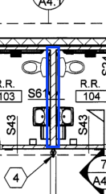
5. **TYPE NO INVENTARIADO** — S41 — Sheet A1.1 (p.37): reading A uses type S41 — not a schedule type (exterior / other framing / typo?) — 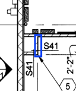
6. **TYPE NO INVENTARIADO** — S42 — Sheet A1.1 (p.37): reading A uses type S42 — not a schedule type (exterior / other framing / typo?) — 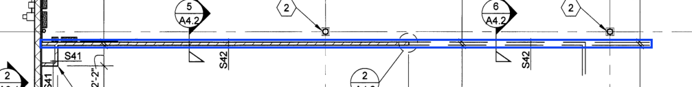
7. **TYPE NO INVENTARIADO** —  — Sheet A1.1 (p.37): reading A uses type  — not a schedule type (exterior / other framing / typo?) — 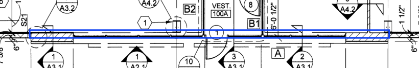
8. **TYPE NO INVENTARIADO** — S21 — Sheet A1.1 (p.37): reading B uses type S21 — not a schedule type (exterior / other framing / typo?) — 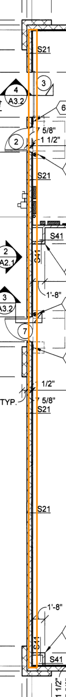
9. **TYPE NO INVENTARIADO** — S24 — Sheet A1.1 (p.37): reading B uses type S24 — not a schedule type (exterior / other framing / typo?) — 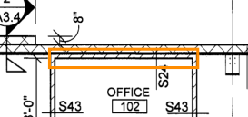
10. **TYPE NO INVENTARIADO** — S43 — Sheet A1.1 (p.37): reading B uses type S43 — not a schedule type (exterior / other framing / typo?) — 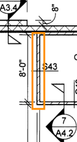
11. **TYPE NO INVENTARIADO** — S61 — Sheet A1.1 (p.37): reading B uses type S61 — not a schedule type (exterior / other framing / typo?) — 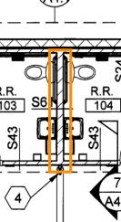
12. **TYPE NO INVENTARIADO** — S41 — Sheet A1.1 (p.37): reading B uses type S41 — not a schedule type (exterior / other framing / typo?) — 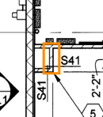
13. **TYPE NO INVENTARIADO** — S42 — Sheet A1.1 (p.37): reading B uses type S42 — not a schedule type (exterior / other framing / typo?) — 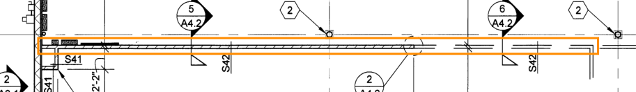
14. **TYPE NO INVENTARIADO** — EXT-8CFMF — Sheet A1.1 (p.37): reading B uses type EXT-8CFMF — not a schedule type (exterior / other framing / typo?) — 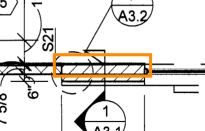
15. **TYPE NO INVENTARIADO** — EXT-6CFMF — Sheet A1.1 (p.37): reading B uses type EXT-6CFMF — not a schedule type (exterior / other framing / typo?) — 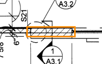

## Notes

- A: S21 (A1.1): ningún segmento trae tag_ids; corte en cada esquina (regla 1 de eje), returns / jogs <= 1.0 ft se suman al tramo que tocan
- A: S24 (A1.1): ningún segmento trae tag_ids; corte en cada esquina (regla 1 de eje), returns / jogs <= 1.0 ft se suman al tramo que tocan
- A: S43 (A1.1): ningún segmento trae tag_ids; corte en cada esquina (regla 1 de eje), returns / jogs <= 1.0 ft se suman al tramo que tocan
- A: S41 (A1.1): ningún segmento trae tag_ids; corte en cada esquina (regla 1 de eje), returns / jogs <= 1.0 ft se suman al tramo que tocan
- A: S42 (A1.1): ningún segmento trae tag_ids; corte en cada esquina (regla 1 de eje), returns / jogs <= 1.0 ft se suman al tramo que tocan
- A:  (A1.1): ningún segmento trae tag_ids; corte en cada esquina (regla 1 de eje), returns / jogs <= 1.0 ft se suman al tramo que tocan
- B: S21 (A1.1): ningún segmento trae tag_ids; corte en cada esquina (regla 1 de eje), returns / jogs <= 1.0 ft se suman al tramo que tocan
- B: S24 (A1.1): ningún segmento trae tag_ids; corte en cada esquina (regla 1 de eje), returns / jogs <= 1.0 ft se suman al tramo que tocan
- B: S43 (A1.1): ningún segmento trae tag_ids; corte en cada esquina (regla 1 de eje), returns / jogs <= 1.0 ft se suman al tramo que tocan
- B: S41 (A1.1): ningún segmento trae tag_ids; corte en cada esquina (regla 1 de eje), returns / jogs <= 1.0 ft se suman al tramo que tocan
- B: S42 (A1.1): ningún segmento trae tag_ids; corte en cada esquina (regla 1 de eje), returns / jogs <= 1.0 ft se suman al tramo que tocan

Legend: blue = reading A, orange = reading B, red circle = inventory tag.
